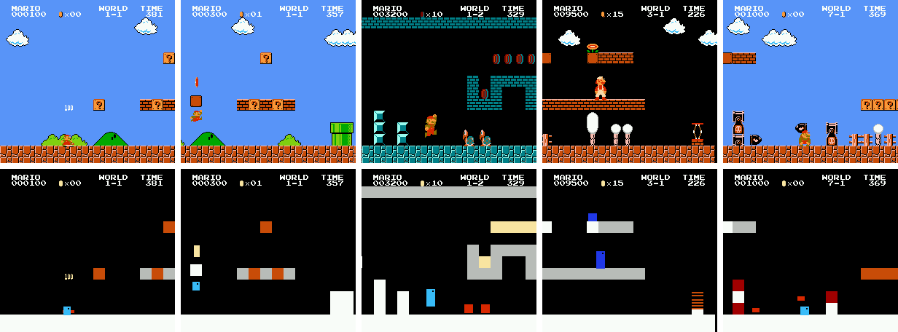

# Mario stimuli, simplified

A copy of the gym-retro integration for Super Mario Bros (NES) used in the
Courtois NeuroMod *mario* dataset, with the same level savestates, scenario and
RAM variable map, but a **visually simplified ROM**: every non-interactive
background detail is transparent, every interactive block is a flat square,
and every sprite object (Mario, enemies, items, fireballs) is a flat rectangle
the exact size and position of its collision box. Colour encodes the semantic
category, and a handful of simple shapes encode the game states that colour
cannot (facing direction, dying, shells, non-stompable enemies, wings).
Sound follows the same rule: no music (a low hum while star power lasts),
one plain tone per kind of event, the decorative effects removed.

The ROM plays exactly like the original. Participant replays (`.bk2`) and
savestates recorded on the original ROM run byte-for-byte identically on it
(only the image and the sound differ), so the simplified version can be used
as an audiovisual-complexity control for both human and AI gameplay.



See [docs/METHOD.md](docs/METHOD.md) for the full description of the method,
its verification, the inventory of what semantic information is kept or lost,
and the known limitations.

## Colour legend

Blocks are coloured by what the player can do with them: nothing (immutable),
break them, hit or use them (interactive), collect them.

| Category | Colour | Objects |
|---|---|---|
| background | black | everything non-interactive (transparent), and the "WORLD x-y" screens |
| immutable | white | ground, stairs, hard blocks, pipes, tree and mushroom ledges, cloud terrain, bridges, used blocks (also while they bounce after a hit), the pedestal and column of a cannon, the base of a springboard, moving platforms |
| breakable | grey | bricks (also while they bounce after a hit) |
| interactive | dark orange | question blocks, springboards, vines |
| collectible | light yellow | coins in the level, coins popping out of blocks, the coin icon of the status bar, floating score numbers |
| item | green | super mushroom |
| 1-up | dark green | 1-up mushroom |
| star | pale pink | starman |
| launcher | dark red | the barrel of a Bullet Bill cannon |
| enemy | red | every enemy and enemy projectile |
| Mario | light blue | the player (flashes blue / green / grey with star power) |
| fire Mario | deep blue | Mario after a fire flower, his fireballs, and the fire flower itself |
| goal | purple | flagpole, ball, flag, flagpole score |

## Shape legend

| Shape | Meaning |
|---|---|
| rectangle size | the object's collision box: big Mario 12x24, small Mario 10x12, crouching 12x12, Koopa-class enemies and items 12x12, Goomba-class enemies 10x6, Hammer Bro 8x24, fireballs and hammers 8x8 |
| 2x2 hole near the top edge of Mario | the side Mario faces |
| hollow rectangle | a Koopa or Buzzy shell (kickable), or Mario dying |
| toothed top edge | an enemy that cannot be stomped (Spiny, Spiny egg, Piranha Plant) |
| 8x2 bar just above an enemy | a Paratroopa (winged; needs two stomps) |
| 16x4 bar on the ground | a squished Goomba (harmless, about to vanish) |
| horizontal stripes | the springboard |

## Sound legend

Every cue is one constant tone; the pitch, length and timbre (square-wave
duty or noise period) tell the categories apart. The tunes the game waits
for keep their original length; the rest is silence.

| Event | Cue |
|---|---|
| jump (small or big), swim stroke | E4, 6 frames, 50 % duty |
| block hit from below, fireball explodes, shell bumps | G3, 4 frames, 12.5 % duty |
| enemy defeated (stomped, hit by a fireball or a shell, Bowser falls) | C5, 6 frames, 25 % duty |
| Mario shrinks | C3, 24 frames, 50 % duty |
| fireball thrown | A5, 3 frames, 12.5 % duty |
| flagpole slide | A4, 64 frames, 50 % duty |
| coin collected | B5, 5 frames, 25 % duty |
| item emerges from a block, vine grows | G4, 16 frames, 12.5 % duty |
| mushroom / flower / star collected | E5, 16 frames, 50 % duty |
| extra life | G5, 16 frames, 25 % duty |
| Bullet Bill fired, Bowser's bridge collapses | G2, 8 frames, 12.5 % duty |
| brick shatters | noise, 12 frames |
| Bowser's flame | noise, 24 frames |
| star power | C3 hum for as long as it lasts |
| time running out | three short A5 beeps |
| death | one C3 tone (24 frames), then silence for the rest of the tune |
| level clear (and castle clear, victory) | C4, E4, G4 (12 frames each), then silence |
| game over | one G2 tone (36 frames), then silence |
| area music, pipe entry, fireworks, end-of-level timer count | removed |

## Contents

| Path | What it is |
|---|---|
| `SuperMarioBros-Nes/rom.nes` | the simplified ROM (git-annex) |
| `SuperMarioBros-Nes/rom.sha` | sha1 of the ROM body (without iNES header), as gym-retro expects |
| `SuperMarioBros-Nes/Level*.state` | level savestates from `mario.stimuli`, with the 32 palette bytes inside rewritten to the simplified palette (otherwise the first "WORLD x-y" screen is black with an original-coloured Mario icon) and, for the two states saved mid-level (4-1, 6-x), the sound engine set idle and the part of the screen that was already drawn redrawn (otherwise the run starts next to a castle in the brick colour); game state unchanged |
| `SuperMarioBros-Nes/data.json`, `scenario.json`, `metadata.json` | RAM variables, reward/done definition, agent benchmarks, unchanged |
| `SuperMarioBros-Nes/one_chance_scenario.json` | same as `scenario.json`, but an episode ends at the first life lost |
| `code/simplify_rom.py` | builds the simplified ROM from the original ROM (the tile, colour, collision-box and shape tables, the sound cues and tunes, and the tiny assembler for the new sound-effect handler live here) |
| `code/verify_replays.py` | replays `.bk2` recordings on two ROMs and checks that the game's memory is identical, and that a savestate of one ROM continues on the other; `--wav DIR` also writes the audio of the replay |
| `code/audit_colours.py` | replays `.bk2` recordings on the simplified ROM and checks the picture against the legend: the colour of every sprite and of every background block, and every drawn rectangle against the game's collision box |
| `code/audit_sound.py` | same for the sound: every cue and tune against the sound legend, read from the sound chip's registers |
| `code/survey_sprite_tiles.py` | measures which sprite tile belongs to which object, used to build the sprite colour table |
| `code/hitbox_survey.py` | measures where each sprite tile sits relative to its object's collision box, used to build the `HITBOX` table |
| `code/fix_state.py` | rewrites the palette, the sound-engine state and the already-drawn screen stored inside a savestate or a recording's `Core.bin` (see below) |
| `code/make_figures.py` | regenerates the figures of `docs/` and `paper/figures/` |
| `generate_sublevels.py` | original helper that regenerates level states |
| `paper/` | manuscript draft (LaTeX) |

## Rebuilding the ROM

```
python code/simplify_rom.py /path/to/original/rom.nes SuperMarioBros-Nes/rom.nes
tail -c +17 SuperMarioBros-Nes/rom.nes | sha1sum | cut -d' ' -f1 > SuperMarioBros-Nes/rom.sha
```

The original ROM is the one annexed in `mario.stimuli`
(md5 `811b027eaf99c2def7b933c5208636de`). The current simplified ROM has md5
`2158c12f805918e359b69160299f11d8` (`ac5251830e8b9a3a3c3f3443d41d2e08` with `--no-sound`, i.e. with the original sound).
`--no-hitbox` gives full-size squares instead of collision-box rectangles,
`--no-marks` removes the shape cues, `--no-sound` keeps the original music
and effects (and the fire bars of the castle levels in the fireball colour:
their red drawing routine sits in the space that the sound patch frees). The
previous version of the ROM (orange question blocks, white cannons, md5
`e0d177c472ea7ca7540fcfd0b6141006`) is commit `93a7ff6`.

After a change of colours, rewrite the level states with the new palette
(they are annexed, so write to a new file and replace the old one):

```
python code/fix_state.py SuperMarioBros-Nes/Level1-1.state Level1-1.new.state --palette-only
```

(without `--palette-only` for the two states saved mid-level, `Level4-1` and
`Level6-x`).

## Checking a ROM against recordings

```
python code/verify_replays.py --jobs 8 integrations/SuperMarioBros-Nes-orig integrations/SuperMarioBros-Nes-simple sub-01_ses-001_task-mario_level-w1l1_rep-000.bk2 [...]
python code/audit_colours.py  --jobs 8 integrations/SuperMarioBros-Nes-simple sub-01_ses-001_task-mario_level-w1l1_rep-000.bk2 [...]
python code/audit_sound.py    --jobs 8 integrations/SuperMarioBros-Nes-simple sub-01_ses-001_task-mario_level-w1l1_rep-000.bk2 [...]
```

where each integration folder holds a `rom.nes` next to copies of this repo's
`*.json` files. Requires stable-retro; no window is opened. The first tool
checks that the game logic is untouched (same memory on every frame as on the
original ROM, and every sprite at the same place), the other two that what is
drawn and played is what the legends above say. Each
exits with status 1 if it finds anything unexpected; see
[docs/METHOD.md](docs/METHOD.md), section 5, for what they check and their
results on the whole dataset. Add `--wav DIR` to `verify_replays.py` to also
get a `.wav` of each replay on the second ROM.

## Replaying existing recordings on the simplified ROM

The game writes its palettes only when an area loads, and a recording's
initial savestate (`Core.bin`) carries the palette that was in the PPU when it
was captured, i.e. the original colours. 3231 of the 3374 dataset recordings
start on the "WORLD x-y" screen: that first screen then shows an
original-coloured Mario icon (later ones, drawn by the simplified ROM after a
death, show a light-blue icon), and the level itself renders correctly
once its palette is written a few frames later. The other 143 (recordings
of level 4-1, whose level state was saved in gameplay) start in gameplay and
would keep the original colours until the next area change; they also carry
the music that was playing, which the simplified ROM would go on playing
until the end of the current section, and the part of the level that was
already on screen, drawn by the original ROM: it stays until it scrolls away,
and shows the castle next to which level 4-1 starts as a wall in the brick
colour. Rewrite the initial state of every recording before replaying; it
makes both cases consistent:

```
unzip -p recording.bk2 Core.bin > Core.bin
python code/fix_state.py Core.bin Core.fixed.bin
```

(or call `fix_state.fix()` on the bytes; `audit_colours.py` and
`audit_sound.py` do it themselves). The tool locates the palette, RAM and
name-table chunks of the fceumm state structurally, so it works whatever the
state currently holds and can be re-run after a change. The rewrite changes
nothing but the 32 palette bytes, seven sound-engine bytes that game logic
never reads, and tiles of the picture already drawn (the PPU's memory, not
the game's); the run is RAM-identical afterwards.
